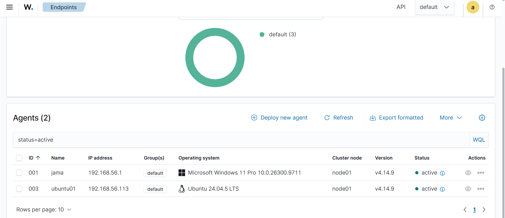
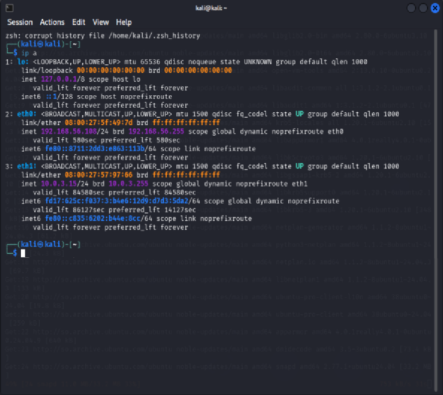
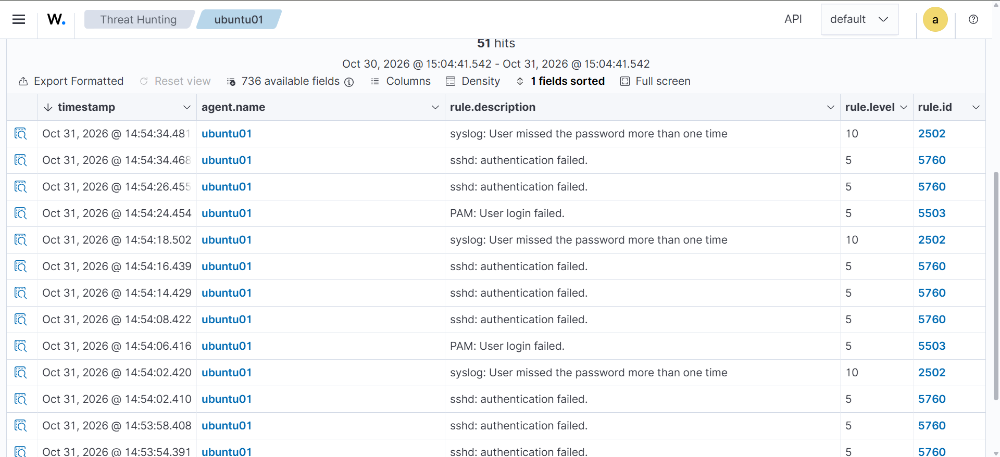
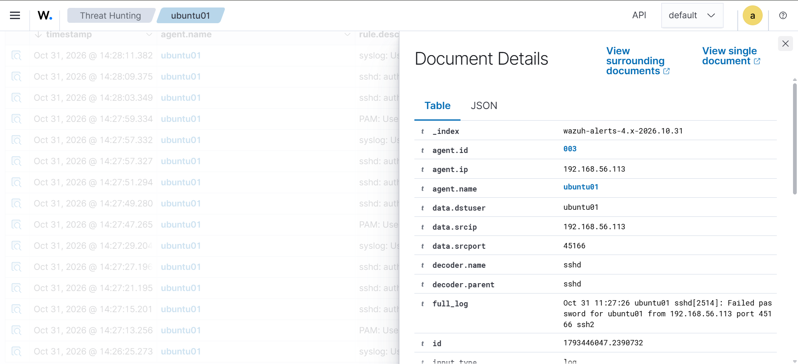
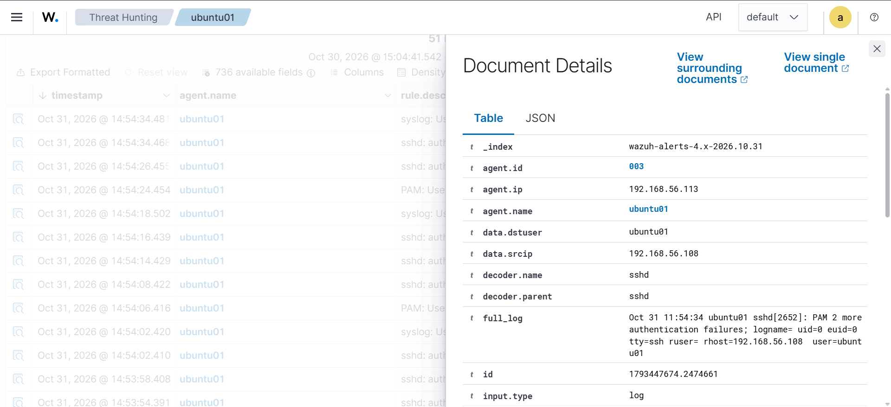
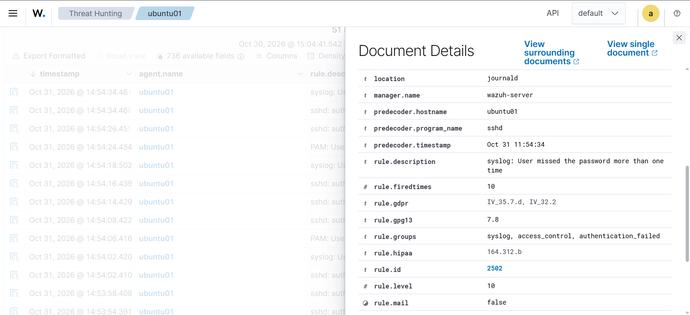
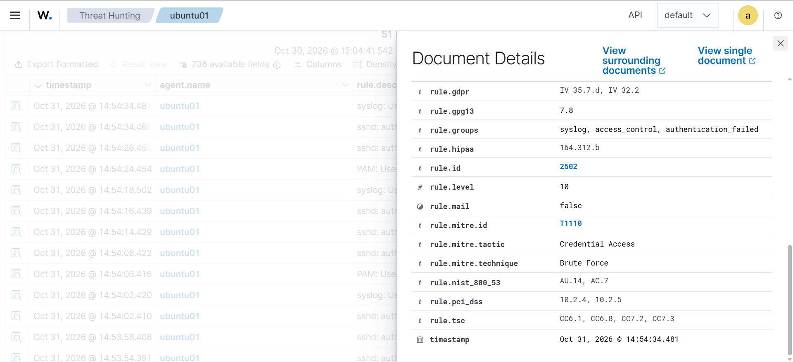
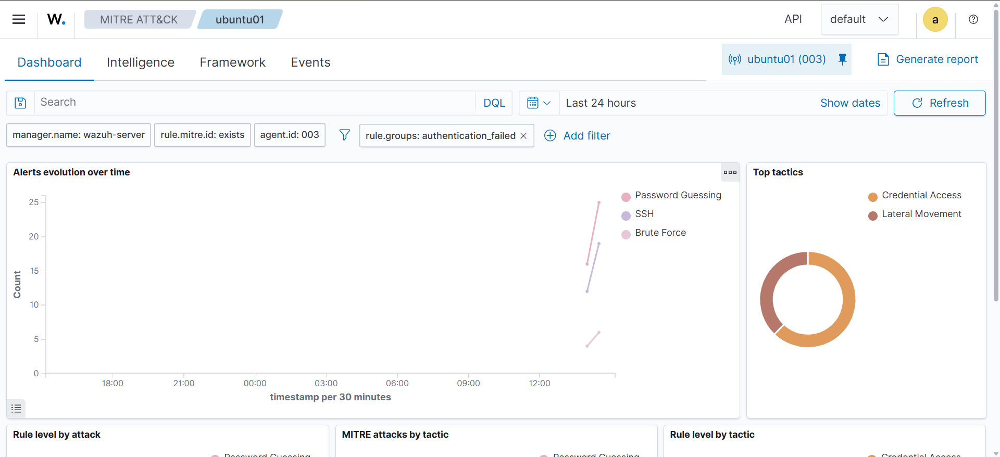
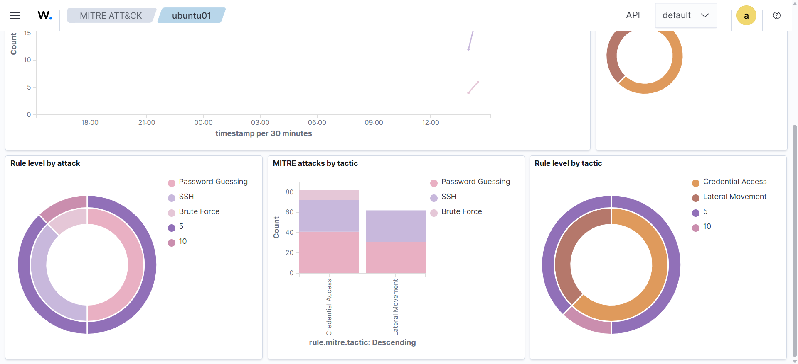

# Lab 03 - Detecting SSH Brute-Force Attempts with Wazuh

**Date:** October 31, 2026
**Platform:** Wazuh 4.14.9, Ubuntu Server 24.04.5 LTS, Kali Linux, Oracle VirtualBox

I enrolled a new Ubuntu Server VM as a Wazuh agent, then generated repeated failed SSH logins against it from Kali Linux. Wazuh detected the activity, raised alerts at two severity levels and mapped them to MITRE ATT&CK techniques for **Brute Force (T1110)** and **Password Guessing (T1110.001)**.

| Step | What I did | Evidence |
|---|---|---|
| 1 | Enrolled `ubuntu01` as Wazuh agent 003 | Screenshot 01 |
| 2 | Confirmed the attacker address on Kali | Screenshot 02 |
| 3 | Generated failed SSH logins and listed the alerts | Screenshot 03 |
| 4 | Read a single failed-login alert (rule 5760) | Screenshot 04 |
| 5 | Read the brute-force alert from Kali (rule 2502) | Screenshots 05, 06, 07 |
| 6 | Reviewed the MITRE ATT&CK dashboard | Screenshots 08, 09 |

---

## Lab environment

Everything ran in an isolated VirtualBox host-only network (`192.168.56.0/24`). I only tested against machines I own.

| Machine | Role | Host-only IP |
|---|---|---|
| Wazuh server | Manager, Indexer and Dashboard (4.14.9) | 192.168.56.105 |
| ubuntu01 (Ubuntu Server 24.04.5 LTS) | Monitored endpoint, Wazuh agent 003 | 192.168.56.113 |
| Kali Linux | Attacker machine | 192.168.56.108 |

## 1. Install the Wazuh agent on Ubuntu

**Goal:** make the Ubuntu VM send its logs to the Wazuh manager.

I downloaded the agent package that matches the manager version and installed it with the manager address set. The agent version must not be newer than the manager, so I used 4.14.9 on both.

```bash
wget https://packages.wazuh.com/4.x/apt/pool/main/w/wazuh-agent/wazuh-agent_4.14.9-1_amd64.deb
sudo WAZUH_MANAGER='192.168.56.105' WAZUH_AGENT_NAME='ubuntu01' dpkg -i ./wazuh-agent_4.14.9-1_amd64.deb
sudo systemctl daemon-reload
sudo systemctl enable --now wazuh-agent
sudo systemctl status wazuh-agent
```

The dashboard lists `ubuntu01` as agent 003, status **active**, version 4.14.9.



**What I learned:** an agent needs two things to work: the same or older version than the manager, and a network path to it. The VM needed both a host-only adapter (to reach the manager) and a NAT adapter (to download the package).

## 2. Confirm the attacker machine

On Kali I checked the host-only address that would be the source of the attempts:

```bash
ip a
```



Kali's `eth0` has `192.168.56.108`, which is the address I expected to see in the alerts.

## 3. Generate failed SSH logins

I tried to log in over SSH with incorrect passwords, first from the Ubuntu VM itself to confirm that log collection worked, then repeatedly from Kali:

```bash
ssh ubuntu01@192.168.56.113
# entered wrong passwords several times in quick succession
```

In the dashboard I opened **Threat Hunting**, selected the `ubuntu01` agent and filtered on `rule.groups: authentication_failed`. The view showed 51 events in the last 24 hours. The failed logins appear as three kinds of alert:



| Rule ID | Level | Description | MITRE technique |
|---|---|---|---|
| 5760 | 5 | sshd: authentication failed | T1110.001 Password Guessing, T1021.004 SSH |
| 5503 | 5 | PAM: User login failed | none |
| 2502 | **10** | syslog: User missed the password more than one time | T1110 Brute Force |

**What I learned:** one failed login produces several alerts, because Linux logs each failure through more than one component (sshd, PAM and syslog). When failures repeat quickly, rule 2502 raises the severity from level 5 to level 10.

## 4. A single failed login (rule 5760)



The `full_log` field holds the raw line Wazuh collected:

```
Oct 31 11:27:26 ubuntu01 sshd[2514]: Failed password for ubuntu01 from 192.168.56.113 port 45166 ssh2
```

This first alert came from the Ubuntu VM itself, so the source IP equals the agent's own IP. It confirmed that SSH logs were reaching Wazuh. Full alert: [evidence/alert-rule-5760.json](evidence/alert-rule-5760.json).

## 5. Repeated failures from Kali (rule 2502)



`data.srcip` is **192.168.56.108** (Kali) and `data.dstuser` is **ubuntu01**. The log line is:

```
sshd[2652]: PAM 2 more authentication failures; logname= uid=0 euid=0 tty=ssh ruser= rhost=192.168.56.108  user=ubuntu01
```



By this point the rule had fired 10 times (`rule.firedtimes: 10`) and carries severity **level 10**.



| Field | Value |
|---|---|
| `rule.id` | 2502 |
| `rule.level` | 10 |
| `rule.groups` | syslog, access_control, authentication_failed |
| `rule.mitre.id` | T1110 |
| `rule.mitre.technique` | Brute Force |
| `rule.mitre.tactic` | Credential Access |

Full alert: [evidence/alert-rule-2502.json](evidence/alert-rule-2502.json).

**What I learned:** the alert already answers the first triage questions: which host, which account, which source IP, how severe, and which ATT&CK technique.

## 6. MITRE ATT&CK view

For agent `ubuntu01`, the MITRE ATT&CK dashboard grouped the activity under two tactics:





| Tactic | Technique |
|---|---|
| Credential Access | T1110 Brute Force, T1110.001 Password Guessing |
| Lateral Movement | T1021.004 Remote Services: SSH |

## 7. Analyst triage notes

If this were a real incident, these are the questions the alert answers:

| Question | Answer from the alert |
|---|---|
| What happened? | Repeated failed SSH password attempts |
| Which host? | ubuntu01 (agent 003, 192.168.56.113) |
| Which account? | ubuntu01 (`data.dstuser`) |
| From where? | 192.168.56.108 (`data.srcip`) |
| How severe? | Level 5 for single failures, level 10 once they repeated |
| Which technique? | T1110 Brute Force (Credential Access) |
| Did it succeed? | Not in this lab. Next check: look for an `Accepted password` event from the same source |

Recommended response in a real environment:

1. Check whether any login from the same source IP succeeded.
2. Block or rate-limit the source IP.
3. Confirm the targeted account is expected and has a strong password.
4. Review the source machine for compromise.

## 8. Hardening recommendations

- Disable SSH password authentication and use key-based login.
- Add rate limiting or `fail2ban`.
- Use Wazuh Active Response to block repeated offenders automatically.
- Restrict SSH access to known management IPs.

## 9. Troubleshooting notes

| Problem | Cause | Fix |
|---|---|---|
| `wget` and `apt update` failed with "Temporary failure in name resolution" | The VM had only a host-only network and no internet | Added a NAT adapter next to the host-only adapter in VirtualBox |
| The Ubuntu installer reported "Block probing did not discover any disks" | The VM had no virtual hard disk attached | Created a 25 GB VDI and attached it to the SATA controller |
| `403 Forbidden` when downloading the agent | Typo in the file name (hyphen instead of underscore) | Corrected the package URL |
| `dpkg` and `systemctl` "command not found" | Typos in the commands | Retyped them and ran each step separately |
| Alert times differ from log times by 3 hours | Logs are in UTC, the dashboard shows local time (UTC+3) | Noted it when comparing the two |

## Summary of skills shown

- Enrolling a Linux endpoint in Wazuh and verifying the connection
- Generating controlled authentication failures in an isolated lab
- Reading Wazuh alerts (rule ID, level, source IP, target user, raw log)
- Mapping alerts to MITRE ATT&CK tactics and techniques
- Writing incident-style triage notes and hardening recommendations
- Debugging virtual lab networking and installation problems

All testing was done on virtual machines I own, inside an isolated lab network.
