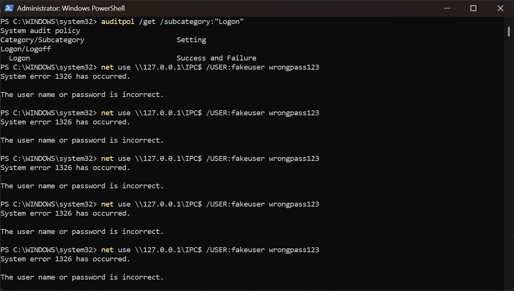
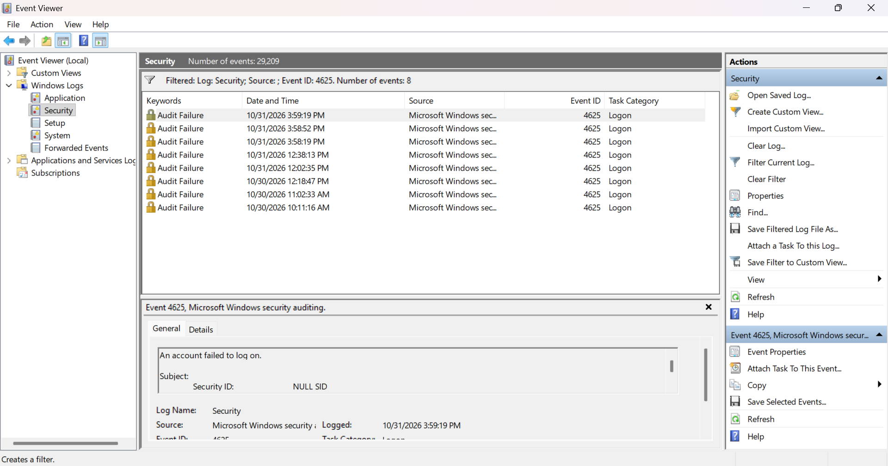
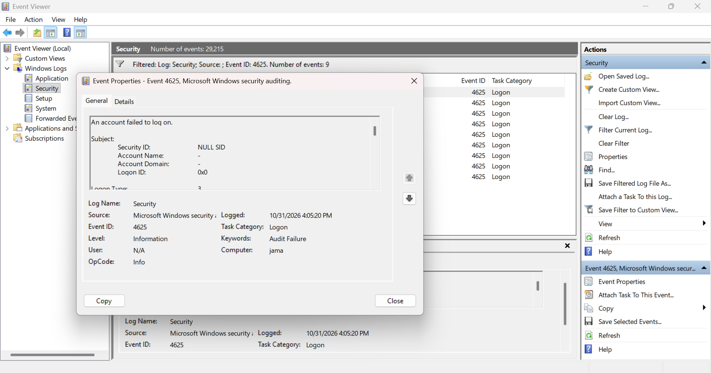
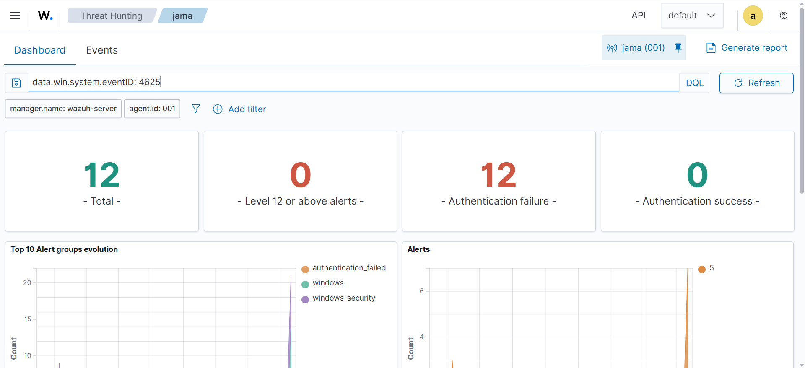
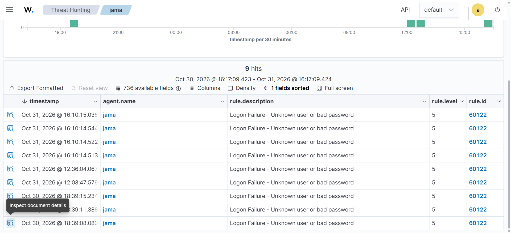
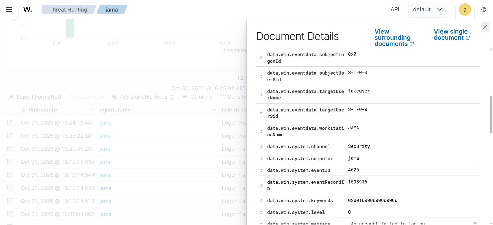
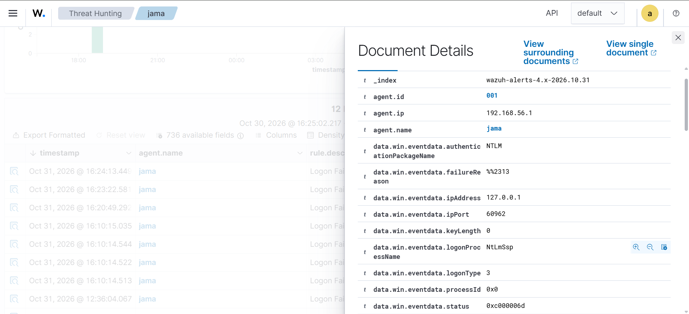
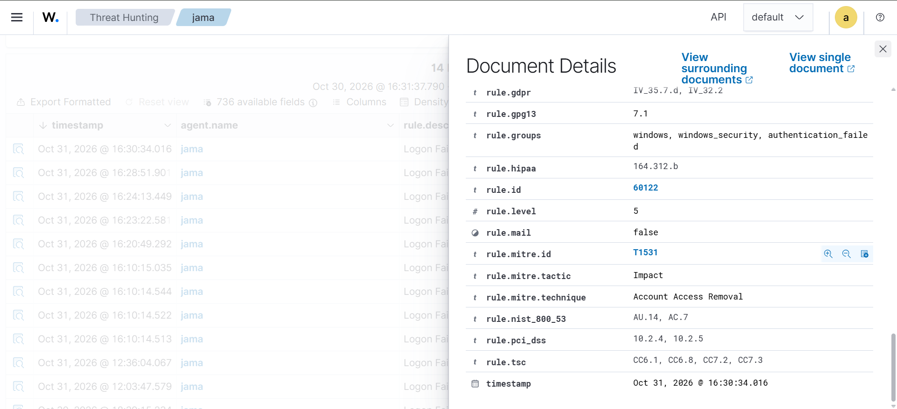

# Lab 04 - Detecting Failed Windows Logons (Event ID 4625) with Wazuh

**Date:** October 31, 2026
**Platform:** Windows 11 Pro (Wazuh agent 001), Wazuh 4.14.9, Windows Event Viewer, PowerShell

In Lab 03 I detected failed SSH logins on Linux. Here I did the same for Windows: I generated failed logons against a user name that does not exist, confirmed that Windows recorded **Event ID 4625**, and found the matching alerts in Wazuh. At the end I compare the Windows and Linux detections.

| Step | What I did | Evidence |
|---|---|---|
| 1 | Checked that Windows audits logon failures, then generated failed logons | Screenshot 01 |
| 2 | Confirmed Event ID 4625 in Windows Event Viewer | Screenshots 02, 03 |
| 3 | Found the alerts in Wazuh Threat Hunting | Screenshots 04, 05 |
| 4 | Read the alert fields and the MITRE mapping | Screenshots 06, 07, 08 |
| 5 | Compared the Windows and Linux detections | Table in section 6 |

---

## Lab environment

Everything ran on my own computer and in my isolated VirtualBox host-only network (`192.168.56.0/24`).

| Machine | Role | Address |
|---|---|---|
| Windows 11 Pro (`jama`) | Monitored endpoint, Wazuh agent 001 | 192.168.56.1 |
| Wazuh server | Manager, Indexer and Dashboard (4.14.9) | 192.168.56.105 |

## 1. Check auditing and generate failed logons

**Goal:** make sure Windows records failed logons, then create some safely.

Windows only logs what its audit policy tells it to. I checked the Logon subcategory in an administrator PowerShell window:

```powershell
auditpol /get /subcategory:"Logon"
```

The setting was **Success and Failure**, so failed logons are recorded.

To create failures without touching any real account, I tried to connect to my own PC with a **user name that does not exist** and a throwaway password:

```powershell
net use \\127.0.0.1\IPC$ /user:fakeuser wrongpass123
```

Each attempt returned **System error 1326: The user name or password is incorrect.**



**What I learned:** logging has to be switched on in the audit policy. A fake user name is a safe way to test detection, because a real account cannot be locked out.

## 2. Confirm Event ID 4625 in Event Viewer

I opened **Event Viewer > Windows Logs > Security** and filtered the log for Event ID 4625. Every failed attempt appears as an **Audit Failure** event in the Logon task category.





The event text begins "An account failed to log on". The **Logon Type is 3**, which means a network logon, and the Subject section shows a **NULL SID** with account name "-". That is normal for failed network logons, because no account was authenticated. The account that was tried is reported further down, in the "Account For Which Logon Failed" section.

**What I learned:** 4625 is the Windows event for a failed logon, and the Logon Type tells you how the attempt was made (2 is interactive at the keyboard, 3 is over the network, 10 is remote desktop).

## 3. Find the alerts in Wazuh

The Wazuh agent on this PC reads the Security log and forwards events to the manager. In **Threat Hunting** I selected agent `jama` and searched:

```
data.win.system.eventID: 4625
```



The dashboard counted the matching alerts all as **authentication failures**, with **0 authentication successes**. In the Events tab, every alert uses **rule 60122**, "Logon Failure - Unknown user or bad password", at **level 5**.



## 4. Read the alert

I opened one of the newest alerts. The `data.win.eventdata` fields tell the story:





| Field | Value | Meaning |
|---|---|---|
| `data.win.system.eventID` | 4625 | Windows failed-logon event |
| `data.win.system.channel` | Security | Source log |
| `data.win.eventdata.targetUserName` | fakeuser | The account that was tried |
| `data.win.eventdata.logonType` | 3 | Network logon |
| `data.win.eventdata.authenticationPackageName` | NTLM | Authentication method |
| `data.win.eventdata.logonProcessName` | NtLmSsp | Logon process |
| `data.win.eventdata.ipAddress` | 127.0.0.1 | Source address (my own PC) |
| `data.win.eventdata.workstationName` | JAMA | Source computer |
| `data.win.eventdata.status` | 0xc000006d | Logon failure |
| `data.win.eventdata.failureReason` | %%2313 | Unknown user name or bad password |
| `data.win.eventdata.subjectUserSid` | S-1-0-0 | Null SID (no authenticated account) |

**What I learned:** a Windows alert carries the same triage information as a Linux one (who was targeted, from where, how, and why it failed), but under different field names.

## 5. MITRE ATT&CK mapping



| Field | Value |
|---|---|
| `rule.id` | 60122 |
| `rule.level` | 5 |
| `rule.groups` | windows, windows_security, authentication_failed |
| `rule.mitre.id` | T1531 |
| `rule.mitre.technique` | Account Access Removal |
| `rule.mitre.tactic` | Impact |

Wazuh's built-in mapping for this rule is **T1531, Account Access Removal (Impact)**. I expected the repeated failed logons to map to Brute Force (T1110, Credential Access), as the Linux rules did in Lab 03. This is a good reminder that the MITRE tags in a SIEM come from the rule authors, so an analyst should check whether the mapping fits the behaviour before putting it in a report. For repeated password guessing, T1110 describes the behaviour better.

## 6. Windows vs Linux detection

| | Lab 03: Linux SSH | Lab 04: Windows |
|---|---|---|
| Log source | sshd / PAM (journald) | Security event log, Event ID 4625 |
| Wazuh rules seen | 5760, 5503, 2502 | 60122 |
| Severity seen | Level 5, then level 10 for repeated failures | Level 5 only |
| MITRE mapping shown | T1110 / T1110.001, T1021.004 | T1531 |
| Source IP field | `data.srcip` | `data.win.eventdata.ipAddress` |
| Target user field | `data.dstuser` | `data.win.eventdata.targetUserName` |
| Why it failed | Free-text log line | Status code and failure reason |

**Finding:** in my tests the Linux detection escalated repeated failures to level 10, but the Windows alerts stayed at level 5 (the dashboard showed 0 alerts at level 12 or above). I did not confirm a Windows rule that escalates repeated failures, so I cannot say whether my bursts were too slow or too few, or whether that rule needs different conditions. I left this as a follow-up instead of guessing.

## 7. Analyst triage notes

| Question | Answer from the alert |
|---|---|
| What happened? | Failed network logons for a user name that does not exist |
| Which host? | jama (agent 001) |
| Which account? | fakeuser (`targetUserName`) |
| From where? | 127.0.0.1, workstation JAMA (my own PC) |
| How? | Logon type 3 (network), NTLM |
| Why did it fail? | Unknown user name or bad password (status 0xc000006d) |
| How severe? | Level 5 |
| Did it succeed? | No. The dashboard showed 0 authentication successes |

In a real incident I would also check for a successful logon (Event ID 4624) from the same source after the failures.

## 8. Hardening recommendations

- Enforce an **account lockout policy** so repeated failures lock the account temporarily.
- Use strong, unique passwords and multi-factor authentication for remote access.
- Restrict network logon rights, and disable or block SMB and remote desktop where they are not needed.
- Alert on a burst of 4625 events followed by a successful 4624.

## Summary of skills shown

- Checking and understanding the Windows audit policy
- Generating safe, controlled failed logons with a non-existent account
- Reading Windows Security event 4625 (logon type, status codes, null SID)
- Finding and interpreting Windows alerts in Wazuh Threat Hunting
- Questioning a SIEM's MITRE ATT&CK mapping instead of accepting it blindly
- Comparing Windows and Linux detections and recording open questions honestly

All testing was done on my own computer, against a user name that does not exist, inside my isolated lab network.
